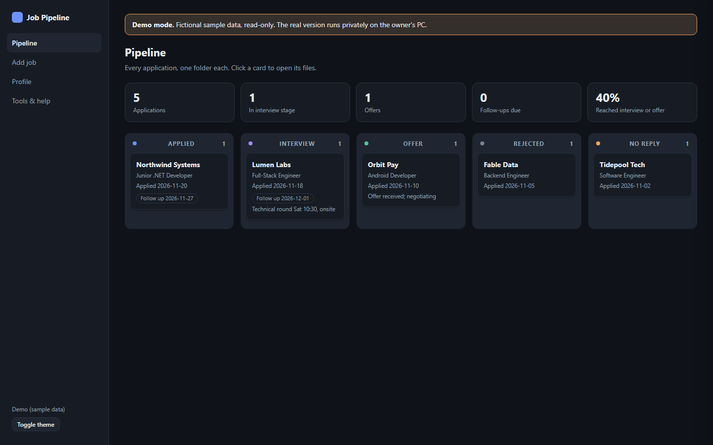
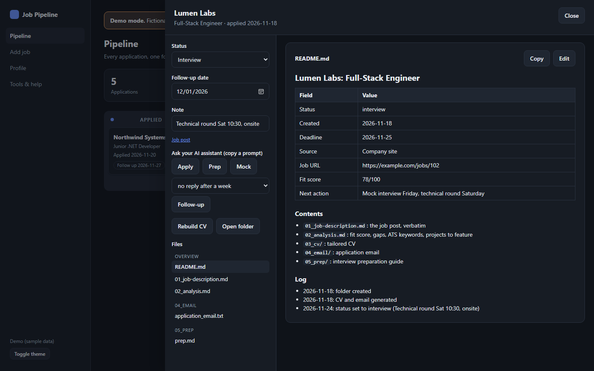
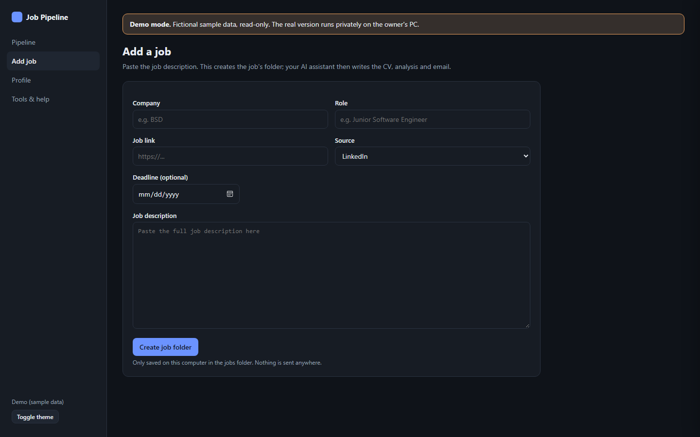

# Job Application System: From Job Post to Offer, Without Fabricating a Single Line

<p align="center">
  
  
  
  
</p>

<p align="center"><b>Paste a job description. Get a tailored CV (PDF), a fit analysis and a professional email. Get an interview call. Get a company-specific preparation guide and a mock interview.</b></p>

<p align="center">Tailored CV • Fit &amp; gap analysis • Application email • Scam check • Interview prep • Mock interviews • Follow-ups • Pipeline dashboard</p>

---

## Table of Contents

- [About the Project](#about-the-project)
- [Why I Built This](#why-i-built-this)
- [Who Will Use It](#who-will-use-it)
- [Why They Will Use It](#why-they-will-use-it)
- [Screenshots](#screenshots)
- [Key Features](#key-features)
- [How It Works](#how-it-works)
- [Tech Stack](#tech-stack)
- [Architecture Overview](#architecture-overview)
- [Getting Started](#getting-started)
- [Configuration](#configuration)
- [Safety Rules](#safety-rules)
- [Project Structure](#project-structure)
- [Roadmap](#roadmap)
- [Contributing](#contributing)
- [License](#license)
- [Author &amp; Contact](#author--contact)

---

## About the Project

**Job Application System** is a local-first toolkit that turns the repetitive, high-stakes part of a job search into a repeatable workflow.

When you apply to many companies, every application needs a CV tuned to that role, an email that sounds like a person, and (if you are invited) real preparation. Doing that by hand takes hours per job, so most people send one generic CV everywhere.

This project gives each application its own folder and a small set of plain-markdown workflows that any AI coding agent can follow:

> Paste a job description → fit analysis and gap report → tailored CV exported to PDF through Word → application email and LinkedIn message → tracker entry with a follow-up date → interview preparation guide → mock interview → thank-you and offer messages.

A built-in **web dashboard** (plain HTML + a tiny Python server) shows the whole pipeline on a Kanban board, lets you add jobs, read and edit every file, and copy ready-made prompts for your AI assistant. It needs **no API key**: the AI work is done by the assistant you already use, working inside this folder.

---

## Why I Built This

I was applying to many software companies at once and noticed the same problems:

1. **Generic CVs lose to targeted ones.** Re-tailoring a CV for every job takes an evening, so I stopped doing it.
2. **AI tools love to embellish.** Asking a chatbot to "improve my CV" often invents skills and metrics. That is dangerous in an interview. I wanted a system where every line is traceable to a profile I control, and where gaps are reported honestly.
3. **Interview prep was ad hoc.** When an interview call came, I had two days and no structure. I wanted a repeatable guide: company research, likely questions from my own CV, honest answers for my gaps, salary research and a time plan.
4. **Applications get lost.** Dozens of applications across LinkedIn, Bdjobs and email need a single place with status and follow-up dates.
5. **Job scams exist.** A mismatched phone number or sender domain should be caught before I share anything.

This is also my exploration of designing **agent-friendly projects**: clear routing in `AGENTS.md`, step-by-step workflows, deterministic scripts for everything that does not need a model, and hard rules the agent cannot bend.

---

## Who Will Use It

- **Fresh graduates and junior developers** sending many applications and needing each CV to speak the job's language.
- **Anyone interviewing at small and mid-size software companies**, where a researched, company-specific answer stands out.
- **Developers who use an AI coding assistant** and want a safe, structured way to use it for their job search.
- **Job seekers who care about honesty:** every claim must come from their own profile.

---

## Why They Will Use It

- **Honest by design.** The agent may reword, reorder and select, but never invent. Gaps are written down and turned into truthful interview answers.
- **Everything for one job lives in one folder,** from the job post to the thank-you note.
- **Keeps your CV's design.** It edits a copy of *your* Word CV (photo, fonts, links and layout intact) and exports the PDF through Word.
- **No API key, no subscription lock-in.** Use any AI coding agent that can read `AGENTS.md`.
- **Private by default.** Your profile, CVs and job folders are git-ignored and never leave your machine. The dashboard binds to `localhost` only.
- **Never sends anything for you.** Emails are saved as text; you review and send.

---

## Screenshots

<p align="center">
  
</p>
<p align="center"><i>Pipeline board: every application by stage, with follow-up reminders. (Fictional demo data.)</i></p>

<p align="center">
  
</p>
<p align="center"><i>Job details: status, follow-up date, prompts for your AI assistant, and every file for that job.</i></p>

<p align="center">
  
</p>
<p align="center"><i>Add a job: paste the description, get a standard folder and the next step.</i></p>

---

## Key Features

### 1. Apply: job description to application pack
- **Legitimacy check** first: company footprint, matching sender domain and phone, no upfront fees
- **Fit analysis:** score out of 100, must-have vs nice-to-have, a match table with evidence from your profile, honest gaps and how to address them
- **ATS keywords** that genuinely apply to you, and which projects to feature
- **Tailored CV:** new summary, reordered skills, selected and reworded project bullets, optional sections kept or dropped, 2-page limit enforced
- **Application email** (120 to 170 words) and a short LinkedIn message
- **Tracker entry** with an automatic follow-up date

### 2. Prep: interview call to preparation guide
- Invitation verification and **company research** (public sources only, unreliable figures flagged)
- Probable questions on **every project and role on your CV**, with answer outlines
- A technical question bank drawn from the job's stack, plus live-coding drills
- **Honest answers for your gaps**, salary research, smart questions to ask, and a day-by-day plan
- A script that **wakes your free-tier demo sites** before you present them

### 3. Mock: practice with a realistic interviewer
- HR, technical, CV deep-dive or full-mix rounds; one question at a time, with follow-ups
- Scored feedback, strengths, fixes, a rewritten stronger answer and the next drill

### 4. Follow-up
- Follow-up after applying, same-day thank-you after an interview, offer comparison and negotiation drafts, graceful rejection replies, and a weekly review of what is working

### 5. Dashboard
- Kanban pipeline with due follow-ups, one-click status changes, file viewer (Markdown rendered, PDF embedded) and editor
- **Add job** form that creates the folder and gives you the next prompt
- Profile editor that highlights unfinished `TODO` items
- Light and dark theme, keyboard-accessible, works on a phone-width screen
- **Demo mode** with fictional data, read-only, safe to show or host

### Cross-cutting
- Plain-markdown workflows readable by humans and agents
- Deterministic scripts for everything that does not need a model
- One standard, numbered folder per application

---

## How It Works

```
1. Add job        paste the description in the dashboard (or tell your agent)
2. Apply          your AI assistant follows workflows/apply.md
                  → analysis, tailored CV PDF, email, LinkedIn message
3. Review & send  you read the PDF and email, and send them yourself
4. Interview?     "Prep" prompt → company research + preparation guide
5. Practise       "Mock" prompt → scored mock interview
6. After          "Follow-up" prompt → thank-you, follow-up, offer notes
```

Each application ends up as one self-contained folder:

```
jobs/2026-11-26_acme_junior-software-engineer/
  README.md               status card and log
  01_job-description.md   the job post, verbatim
  02_analysis.md          fit score, gaps, keywords
  03_cv/                  cv_spec.json, tailored .docx and .pdf (upload the PDF)
  04_email/               application email, LinkedIn message, cover letter
  05_prep/                company research, prep guide, mock interviews
  06_followups/           follow-ups, thank-you, debrief, offer notes
```

---

## Tech Stack

| Layer | Technology |
|---|---|
| Workflows | Plain Markdown (`AGENTS.md`, `workflows/*.md`), readable by any AI coding agent |
| Scripts | Python 3.10+ (standard library, `python-docx`, `pywin32`) |
| CV export | Microsoft Word COM automation (edits a copy of your `.docx`, exports PDF) |
| Dashboard server | Python standard library `http.server`, no framework, localhost only |
| Dashboard UI | Single HTML file, vanilla JavaScript and CSS, no build step, no CDN |
| Data | Files on disk: Markdown, JSON, CSV (`applications.csv`) |

---

## Architecture Overview

```
┌────────────────────┐       prompts        ┌─────────────────────────┐
│  Dashboard (HTML)  │ ───────────────────▶ │   AI coding assistant   │
│  pipeline · files  │                      │   reads AGENTS.md and   │
└─────────┬──────────┘                      │   workflows/*.md        │
          │ JSON over localhost             └───────────┬─────────────┘
┌─────────▼──────────┐                                  │ writes files
│  ui/server.py      │       calls                      ▼
│  (stdlib, local)   │ ───────────────▶  ┌────────────────────────────┐
└────────────────────┘                   │ scripts/                    │
                                         │  new_job · build_cv · track │
                                         │  to_pdf · check_links       │
                                         └─────────────┬──────────────┘
                                                       ▼
                                  profile/ (your facts)  +  jobs/<one folder per job>
```

- **The profile is the single source of truth.** Everything written about you must trace back to `profile/master_profile.md` or something you confirmed in chat.
- **Scripts do the deterministic work** (folder layout, CV editing, PDF export, tracking). The assistant does the judgement work (analysis, wording, research).
- **The dashboard never calls an AI.** It manages files and hands you prompts.
- **Security:** the server binds to `127.0.0.1`, rejects foreign `Host` headers, requires a custom header on writes, restricts paths to `jobs/` and `profile/`, and limits editable file types.

---

## Getting Started

### Prerequisites
- Windows with **Microsoft Word** (used to export the PDF)
- **Python 3.10+**
- Any **AI coding assistant** that can open a folder and read `AGENTS.md`

### Install
```powershell
git clone https://github.com/InfinityAbir/Job-Application-System.git
cd Job-Application-System
pip install -r requirements.txt
```

### Try the demo first (no setup, fictional data)
```powershell
python ui/server.py --demo
```
Open http://127.0.0.1:8765. The demo is read-only.

### Set up your own profile
1. Copy `profile/master_profile.example.md` to `profile/master_profile.md` and fill it in. Add your known gaps honestly.
2. Copy `profile/stories.example.md` to `profile/stories.md` and write your interview stories.
3. Copy `profile/links.example.txt` to `profile/links.txt` and list your live demos.
4. Put your Word CV at `profile/base_cv.docx` (see [profile/README.md](profile/README.md) for the required headings) and adjust `PROJECT_KEYS` in `scripts/build_cv.py` to your project names.

### Run it
```powershell
python ui/server.py        # dashboard at http://127.0.0.1:8765
```
Then **Add job**, paste the description, copy the prompt, and paste it into your AI assistant opened in this folder.

You can also skip the dashboard and tell your assistant in plain words: *"Apply to this job: ..."*, *"Prepare me for my interview at ..."*, *"Run a mock interview"*. `AGENTS.md` routes each request to the right workflow.

### Handy commands
```powershell
python scripts/new_job.py "Acme" "Junior Developer" --url https://...   # create a job folder
python scripts/build_cv.py jobs/<folder>                                 # rebuild the tailored CV PDF
python scripts/track.py list                                             # all applications
python scripts/track.py due                                              # follow-ups due today
python scripts/check_links.py                                            # wake your live demo sites
```

---

## Configuration

| Setting | Where |
|---|---|
| Your facts, preferences, salary range | `profile/master_profile.md` |
| Interview stories | `profile/stories.md` |
| Live demo links | `profile/links.txt` |
| CV template | `profile/base_cv.docx` |
| Project name to id mapping | `PROJECT_KEYS` in `scripts/build_cv.py` |
| CV tailoring per job | `jobs/<folder>/03_cv/cv_spec.json` (schema in `scripts/build_cv.py`) |

No environment variables or API keys are required.

---

## Safety Rules

These are written into `AGENTS.md` so every agent follows them:

1. **No fabrication.** No invented employers, dates, metrics, skills, degrees or certificates.
2. **Gaps are reported, not hidden,** and turned into truthful interview answers.
3. **Publication status is exact:** accepted vs under review.
4. **Nothing is ever sent.** Emails and messages are saved as text for you to review.
5. **Privacy.** Personal details stay in local files; research queries contain only company names and public topics.
6. **Scam awareness.** Every job gets a legitimacy check before documents are produced.

---

## Project Structure

```
Job-Application-System/
├── AGENTS.md                 entry point for any AI agent: purpose, routing, hard rules
├── README.md
├── LICENSE
├── requirements.txt
├── profile/                  your private data (git-ignored) + *.example templates
├── workflows/                apply.md · prep.md · mock.md · followup.md
├── scripts/
│   ├── new_job.py            create the standard job folder + tracker entry
│   ├── build_cv.py           cv_spec.json → tailored .docx → PDF
│   ├── to_pdf.py             docx → pdf through Word, prints page count
│   ├── track.py              application tracker (applications.csv)
│   └── check_links.py        wake live demo links
├── ui/
│   ├── server.py             local dashboard server (--demo for sample data)
│   ├── index.html            the dashboard
│   └── demo/                 fictional sample data
├── docs/screenshots/
└── jobs/                     one folder per application (git-ignored)
```

---

## Roadmap

- [ ] Cover-letter template builder from the Word CV style
- [ ] Skill-gap report across all saved job descriptions ("what should I learn next?")
- [ ] LibreOffice backend so PDF export also works without Word
- [ ] macOS and Linux support
- [ ] Optional import of a job post from a URL
- [ ] Export the pipeline as a weekly summary

---

## Contributing

Issues and pull requests are welcome. Keep these principles when contributing:
- Workflows in `workflows/` are the single source of truth; agent-specific shortcuts must only point to them.
- Anything deterministic belongs in a script, not in a prompt.
- Never add features that fabricate content or send messages without review.
- Never commit personal data; use the `*.example` pattern.

---

## License

Released under the [MIT License](LICENSE).

---

## Author &amp; Contact

**Abir Hasan**: Software Engineer (Full-Stack and Blockchain)

- GitHub: [github.com/InfinityAbir](https://github.com/InfinityAbir)
- LinkedIn: [linkedin.com/in/infinityabirhasan](https://linkedin.com/in/infinityabirhasan)

If this helps your job search, a star is appreciated.
